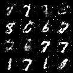

# Modèles génératifs sur MNIST

## Présentation

Ce TP compare un modèle **discriminatif** et quatre familles de modèles **génératifs** sur le jeu de données MNIST (chiffres manuscrits de 28 × 28 pixels).

Le modèle discriminatif apprend à reconnaître un chiffre. Les modèles génératifs apprennent à créer de nouvelles images de chiffres.

Tout est codé avec PyTorch dans un seul notebook : `modeles_generative.ipynb`.

## Les parties du TP

### Partie I — Modèle discriminatif

- Un classifieur simple (MLP : 784 → 128 → 10) prédit le chiffre d'une image.
- Entraînement : 3 époques, perte `CrossEntropyLoss`, optimiseur Adam.
- Résultat : **accuracy de 95,99 %** sur le jeu de test (mesurée avec `torcheval`).

### Partie II — Autoencodeur (AE)

- Un encodeur compresse l'image en un vecteur de **2 dimensions** (l'espace latent), puis un décodeur reconstruit l'image.
- Entraînement : 5 époques, perte `MSELoss` (perte finale : 0,0454).
- Visualisations : images originales et reconstruites, et espace latent en 2D coloré par chiffre.
- Fonction `generer_chiffre` : génère un chiffre choisi en décodant la moyenne des vecteurs latents de ce chiffre.

### Partie III — Autoencodeur variationnel (VAE)

- L'encodeur prédit une moyenne `mu` et une variance `logvar`. On tire `z` avec l'astuce de reparamétrisation.
- Perte : reconstruction (`binary_cross_entropy`) + divergence KL, qui rend l'espace latent continu et proche d'une loi normale.
- Entraînement : 20 époques (perte finale : 142,62 = reconstruction 136,17 + KL 6,44).
- Visualisations : reconstructions, espace latent, nouveaux chiffres tirés au hasard, et grille 15 × 15 qui parcourt l'espace latent de −3 à 3.

### Partie IV — Réseaux antagonistes génératifs (GAN)

- Un **générateur** transforme un bruit de dimension 100 en image. Un **discriminateur** essaie de distinguer les vraies images des fausses.
- Perte `BCEWithLogitsLoss`, Adam (`lr = 0,0002`, `betas = (0,5 ; 0,999)`), 20 époques.
- Les deux réseaux s'opposent : à la fin, perte D ≈ 0,47 et perte G ≈ 1,51.
- Une grille d'images est sauvegardée à chaque époque dans `images_generees/`, et les poids du générateur dans `generator_mnist.pt`.

### Partie V — Modèle de diffusion

- On ajoute du bruit à une image en **200 étapes** (calendrier cosinus), puis un petit **U-Net** apprend à prédire ce bruit.
- Le U-Net reçoit l'étape `t` sous forme d'embedding sinusoïdal.
- Entraînement : 20 époques, perte MSE sur le bruit (perte finale : 0,0408).
- Génération : on part d'un bruit pur et on retire le bruit étape par étape pour obtenir un chiffre.

## Résultats

| Modèle | Rôle | Résultat |
|---|---|---|
| Classifieur | Reconnaître un chiffre | Accuracy 95,99 % |
| Autoencodeur | Compresser et reconstruire | MSE 0,0454 |
| VAE | Générer avec un espace latent continu | Perte 142,62 |
| GAN | Générer par compétition G / D | D ≈ 0,47, G ≈ 1,51 |
| Diffusion | Générer en retirant le bruit | MSE bruit 0,0408 |

Chiffres générés par le GAN après 20 époques :



Évolution du GAN : [époque 1](images_generees/epoch_001.png) → [époque 20](images_generees/epoch_020.png).

## Technologies

| Rôle | Outil |
|---|---|
| Réseaux de neurones | PyTorch |
| Jeu de données | torchvision (MNIST) |
| Métrique | torcheval (`MulticlassAccuracy`) |
| Graphiques | Matplotlib, NumPy |
| Environnement | uv, PyTorch CUDA 13.0 |

## Structure du projet

```
.
├── modeles_generative.ipynb   # notebook du TP (les 5 parties)
├── images_generees/           # grilles du GAN, une par époque
├── generator_mnist.pt         # poids du générateur GAN entraîné
├── pyproject.toml             # dépendances
├── uv.lock
└── data/                      # MNIST, téléchargé automatiquement (non versionné)
```

## Installation

Prérequis : Python 3.12 et [uv](https://docs.astral.sh/uv/). Un GPU NVIDIA est conseillé ; sans GPU, le code tourne sur CPU, plus lentement.

```bash
git clone https://github.com/BouthainaBoubou/tp2_Mod-les-g-n-ratifs.git
cd tp2_Mod-les-g-n-ratifs
uv sync
```

## Utilisation

1. Ouvrir `modeles_generative.ipynb` avec le kernel `.venv` du projet.
2. Exécuter les cellules dans l'ordre.

MNIST est téléchargé automatiquement dans `data/` à la première exécution.

## Limites

- Les modèles sont volontairement simples (couches linéaires, petit U-Net) : les images générées restent floues ou imparfaites.
- L'espace latent de l'AE et du VAE n'a que 2 dimensions, pour pouvoir l'afficher. Une dimension plus grande donnerait de meilleures images.
- L'entraînement d'un GAN est instable : les pertes D et G montent et descendent, elles ne baissent pas toujours.
- Le modèle de diffusion est le plus lent à générer, car il faut 200 étapes de débruitage par image.
